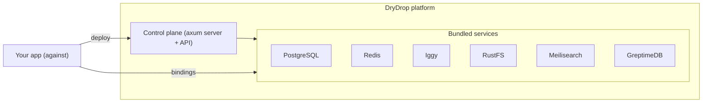

# DryDrop

<p align="center">
  <strong>A self-hosted, Cloudflare-style platform for Rust applications.</strong>
</p>

<p align="center">
  Write your app against the <code>against</code> framework, and DryDrop provisions the services it needs
  — PostgreSQL, Redis, Iggy, RustFS, Meilisearch, GreptimeDB — then runs it on your own hardware or VPS.
</p>

## What is DryDrop?

Cloudflare gives you a place to run code plus a set of managed services to run it *against*: KV, D1, R2,
Queues, Workers Logs. You write the application, the platform supplies storage, messaging, search, and
observability, and the runtime wires the two together.

DryDrop is that model, self-hosted and Rust-first:

- **Batteries included.** Deploying the platform brings up the backing services as containers — no
young-project tax of assembling Postgres, a queue, object storage, and a search engine before writing
the first line of app code.
- **Your code, typed bindings.** Applications are written against the [`against`](#the-against-framework)
framework — a Rust framework in the spirit of Cloudflare's [`workers-rs`](https://github.com/cloudflare/workers-rs)
— so binding to a service is a typed call, not a hand-rolled HTTP client with credentials copied out of
a dashboard.
- **Portable by default.** The same application should run on a spare machine at home, a cloud VPS, or a
serverless target. Infrastructure adapts to the application, not the other way around.

## How it fits together



The **control plane** is the `server` app: it owns configuration, the HTTP API, persistence, caching, and
mail, and it is what provisions and supervises the service stack. The **services** are ordinary
open-source servers with the same roles as Cloudflare's managed primitives:

| DryDrop service | Role | Cloudflare counterpart |
| --- | --- | --- |
| PostgreSQL | Relational storage | D1 / Hyperdrive |
| Redis | Cache, sessions, ephemeral state | KV / cache |
| Iggy | Message queue and streams | Queues |
| RustFS | S3-compatible object storage | R2 |
| Meilisearch | Full-text and vector search | AI Search |
| GreptimeDB | Metrics, logs, time-series | Workers Logs / Analytics |

The exact images and versions live in
[`deployments/docker/docker-compose.yaml`](deployments/docker/docker-compose.yaml); that file is the
source of truth, and this table only names the roles.

> **Note:** GreptimeDB is the target for the observability role but is not yet wired into the compose
> stack, so read `deployments/docker/docker-compose.yaml` for what actually starts today.


## The `against` framework

`against` is the application-facing half of DryDrop, and it lives in its own repository:
**[jason-darcy/against](https://github.com/jason-darcy/against)**. It is the piece that makes the
Cloudflare comparison concrete:

| Aspect | Cloudflare | DryDrop |
| --- | --- | --- |
| App framework | `workers-rs` | `against` |
| Deploy target | Cloudflare's edge | your hardware, VPS, or serverless |
| Service bindings | KV, D1, R2, Queues, Logs | PostgreSQL, Redis, Iggy, RustFS, Meilisearch, GreptimeDB |

With `workers-rs` you declare a binding in config and reach it through a typed interface provided by the
runtime. `against` is intended to work the same way: your application declares which services it uses,
the platform injects connection details and lifecycle, and the code talks to a service through the
framework's API instead of through credentials it manages itself.

> **Status:** `against` is at day one. The repository is scaffolded, and
> [`against` 0.1.0 on crates.io](https://crates.io/crates/against) is a placeholder release that reserves
> the name — one line of code, an empty API, nothing stable. The bindings described above are the intended
> design, not current behavior. This repository is the control plane and the shared crates it is built
> from, and does not yet depend on `against`.

## Repository layout

This is a single Cargo workspace (`apps/*` and `crates/*`) with a shared Dioxus component library.

### Apps

| App | Binary | Purpose |
| --- | --- | --- |
| `apps/server` | `drydrop-server` | Control plane: axum HTTP API, Swagger UI, persistence, caches, mail |
| `apps/web` | `DryDrop` | Browser UI (Dioxus, WebAssembly) |
| `apps/desktop` | `DryDrop` | Desktop UI (Dioxus) |
| `apps/mobile` | `DryDrop` | iOS UI (Dioxus) |
| `apps/tui` | `drydrop-tui` | Terminal UI (ratatui) |
| `apps/cli` | `drydrop` | Command-line client |

### Crates

| Crate | Purpose |
| --- | --- |
| `crates/drydrop` | Shared facade crate; exposes `config`, `domain`, `error`, and (with the `server` feature) `infra` |
| `crates/drydrop-config` | Layered configuration loaded from `config/.env` plus `__`-separated environment variables |
| `crates/drydrop-domain` | Domain model and auth schemas: user, account, session, organization, passkey, two-factor, verification |
| `crates/drydrop-infra` | Infrastructure adapters: PostgreSQL persistence, Moka/Redis caches, Resend and Cloudflare mail transports |
| `crates/drydrop-error` | Shared error type |
| `crates/dioxus-components` | Dioxus UI components and Tailwind assets used by the web, desktop, and mobile apps |

Inside `apps/server` the code is layered: `presentation` (HTTP, routes, DTOs, middlewares) →
`application` (commands, queries, views) → `infrastructure` (persistence, caches, mail, messaging).

## Quick start

### Prerequisites

- [mise](https://mise.jdx.dev) — pins the Rust toolchain, `mbx`, `watchexec`, and `hurl`
- [just](https://github.com/casey/just) — task runner for the dev workflows below
- Docker or Podman with Compose — runs the bundled services
- Node.js 24 with pnpm — builds the Tailwind stylesheet
- [Dioxus CLI](https://dioxuslabs.com/learn/0.7/getting_started) (`dx`) — only needed for the web, desktop, and mobile apps

### Run from source

```bash
# 1. Clone and install the pinned toolchain
git clone https://github.com/Homeryland/DryDrop.git
cd DryDrop
mise install

# 2. Build frontend assets (pnpm install + Tailwind CSS)
mise bootstrap

# 3. Create the config the server and Compose both read
cp config/.env.example config/.env
#    then edit JWT_SECRET and OWNER_EMAIL at minimum

# 4. Bring up the services and start the control plane
just server
```

`just server` starts the service stack with Docker first, then runs the server under `watchexec`, and
shuts the stack down when the server exits.

With the server up:

- API: <http://localhost:7878/api/v1>
- Health: <http://localhost:7878/api/v1/health>
- Swagger UI: <http://localhost:7878/docs>

### Development commands

| Command | What it does |
| --- | --- |
| `just start` | Start the service stack in the background |
| `just stop` | Stop the stack and delete its data directories |
| `just server` | Start the stack, then run the server with auto-reload |
| `just web` | Serve the web app with `dx serve` |
| `just desktop` | Serve the desktop app with `dx serve` |
| `just ios` | Serve the mobile app on an iOS simulator |
| `just cli` | Build and run the CLI |
| `just tui` | Build and run the TUI |

> `just stop` removes the service data under `deployments/docker/`, so treat it as a reset, not a pause.

## Project status

DryDrop is in early development; APIs and workflows will change.

**Working today**

- Cargo workspace with six apps sharing one domain, config, and infrastructure layer
- Control plane on axum: layered architecture, health endpoint, OpenAPI document, and Swagger UI
- Config crate reading `config/.env` with `__`-separated overrides
- Auth domain schemas, mail templates, and Moka/Redis cache and PostgreSQL adapters
- One-command local stack for PostgreSQL, Redis, Iggy, RustFS, and Meilisearch

**Not built yet**

- The `against` framework itself — repository scaffolded, API not implemented — and its service bindings
- The deployment engine: scheduling, rolling out app versions, and per-app service provisioning
- Control-plane API surface beyond health, and the UI apps and CLI beyond their current scaffolds

## Contributing

Contributions are welcome — bug reports and feature ideas as much as code. Keep pull requests focused, and
open an issue to discuss the approach first for larger changes.

CI runs the same checks you can run locally:

```bash
cargo fmt --all -- --check
cargo clippy --workspace --all-features --locked -- -D warnings
cargo test --workspace --all-features --locked
```

If you change Tailwind styles, rebuild and commit the generated CSS — CI fails when it is out of date:

```bash
pnpm exec tailwindcss -i crates/dioxus-components/tailwind.css -o crates/dioxus-components/assets/tailwind.css
```

## License

DryDrop is licensed under the [MIT License](LICENSE). The `against` framework is a separate project and
is dual-licensed MIT OR Apache-2.0.
